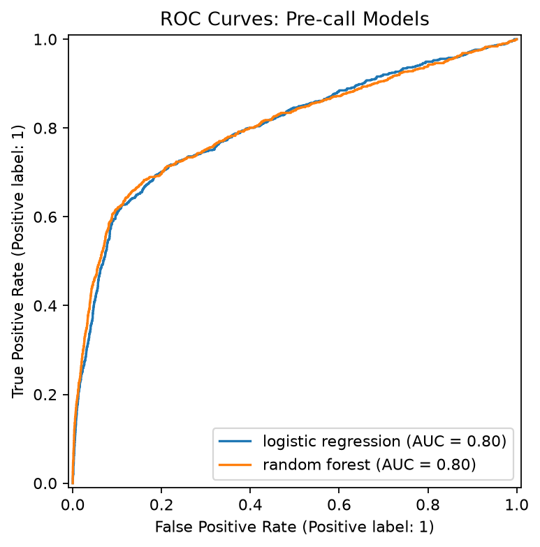
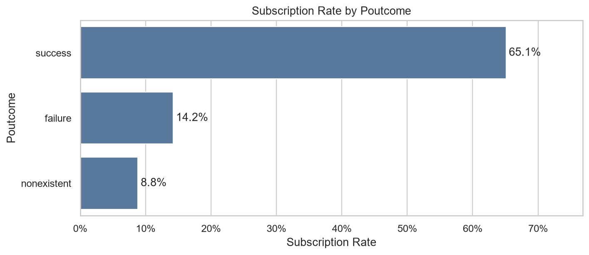
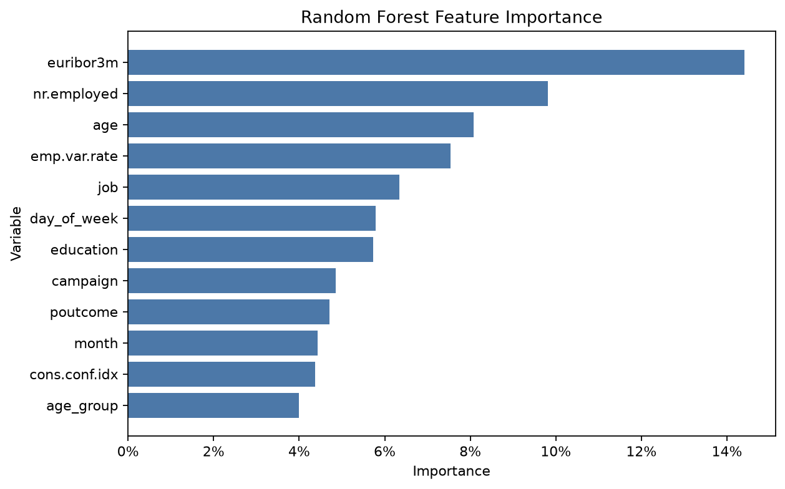
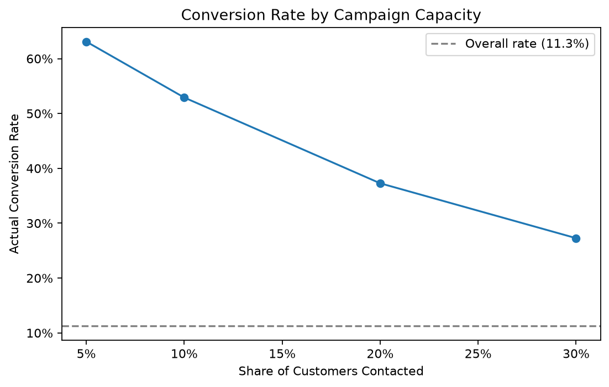

# 银行营销定期存款预测分析

> 使用机器学习为银行电话营销活动筛选高潜力客户，并将模型结果转化为可执行的外呼容量策略。

## 项目概览

银行电话营销成本高，而订购定期存款的客户占比较低。本项目基于 **41,188** 条银行营销记录，完成数据清洗、探索性分析、特征工程、模型比较、模型解释和营销策略评估，目标是在**通话前**预测客户订购定期存款的可能性。

清洗后保留 **41,176** 条记录；目标客户占比约 **11.3%**。模型严格排除了仅能在通话结束后获得的 `duration` 字段，避免信息泄露。

## 核心结果

| 项目 | 结果 |
|---|---:|
| 最终模型 | 随机森林 |
| ROC-AUC | **0.803** |
| PR-AUC | **0.487** |
| 前 10% 客户的实际转化率 | **52.9%** |
| 前 10% 客户覆盖的潜在订购者 | **47.0%** |

随机森林相较逻辑回归有相近的 ROC-AUC，但在类别不平衡场景更关键的 PR-AUC 与 Precision 上表现更好，因此被选作客户评分模型。

| 模型 | ROC-AUC | PR-AUC | Precision | Recall |
|---|---:|---:|---:|---:|
| 随机森林 | **0.803** | **0.487** | **0.452** | 0.610 |
| 逻辑回归 | 0.801 | 0.448 | 0.363 | **0.650** |



## 关键发现

**历史营销结果最具参考价值。** 曾在既往活动中成功订购的客户，本次订购率为 **65.1%**；既往失败和无既往联系记录的客户分别为 **14.2%**、**8.8%**。该信息适合用作再营销优先级的重要输入。



模型的重要变量包括 `euribor3m`、`nr.employed`、`age`、`emp.var.rate`、`job`、`education`、`campaign` 和 `poutcome`。特征重要性仅说明模型在历史数据中的依赖程度，**不代表因果关系**。



## 营销建议

将候选客户按模型预测概率从高到低排序，并依据团队外呼产能确定联系范围：

| 优先联系范围 | 联系客户数（测试集） | 实际转化率 | 覆盖潜在订购者 |
|---|---:|---:|---:|
| 前 5% | 412 | 63.1% | 28.0% |
| **前 10%（资源紧张时推荐）** | **824** | **52.9%** | **47.0%** |
| 前 20%（追求覆盖时推荐） | 1,647 | 37.3% | 66.2% |
| 前 30% | 2,471 | 27.3% | 72.6% |



**结论：** 资源紧张时优先联系模型评分前 10% 的客户；若希望获得更高的潜在订购者覆盖率，可扩展至前 20%。实际部署时还应结合电话成本、单笔存款收益、合规要求和团队产能确定最终阈值。

## 分析流程

```text
原始营销数据
    ↓
数据清洗：去除 12 条重复记录，保留 unknown 为显式类别
    ↓
探索性分析：客户特征、联系渠道、历史营销结果与宏观指标
    ↓
特征工程：年龄段、是否曾联系、贷款标记、通话前可用变量
    ↓
建模评估：逻辑回归 vs. 随机森林（80/20 分层训练/测试划分）
    ↓
按预测概率排序，输出外呼优先级与容量策略
```

## 项目结构

```text
notebooks/       01–07：从数据理解到模型解释的完整分析流程
src/             可复用的数据处理、特征工程、建模与绘图函数
figures/final/   GitHub 展示用的关键图表
reports/         完整分析报告与指标结果 CSV
requirements.txt Python 依赖清单
```

完整文字报告请见 [reports/final_report.md](reports/final_report.md)。

## 复现项目

```bash
git clone https://github.com/changqingg7/bank-marketing-analysis.git
cd bank-marketing-analysis
python -m pip install -r requirements.txt
jupyter notebook
```

请从项目根目录按编号依次运行 `notebooks/01_data_understanding.ipynb` 至 `notebooks/07_model_interpretation.ipynb`。

> 为保持仓库轻量，原始数据、中间数据、大量生成图表和 PPT 不纳入版本控制；仓库保留可复现的 Notebook、源代码、最终报告、结果表格和关键展示图。

## 局限性与负责任使用

- 历史数据中的相关性不能被解释为因果关系。
- 模型需要在新的营销周期中持续验证，并定期重新训练。
- 年龄、职业、教育等变量只适合辅助分层，不应作为唯一的客户排除规则。
- 不应使用本次通话时长等通话后信息，预测模型只服务于通话前筛选。
