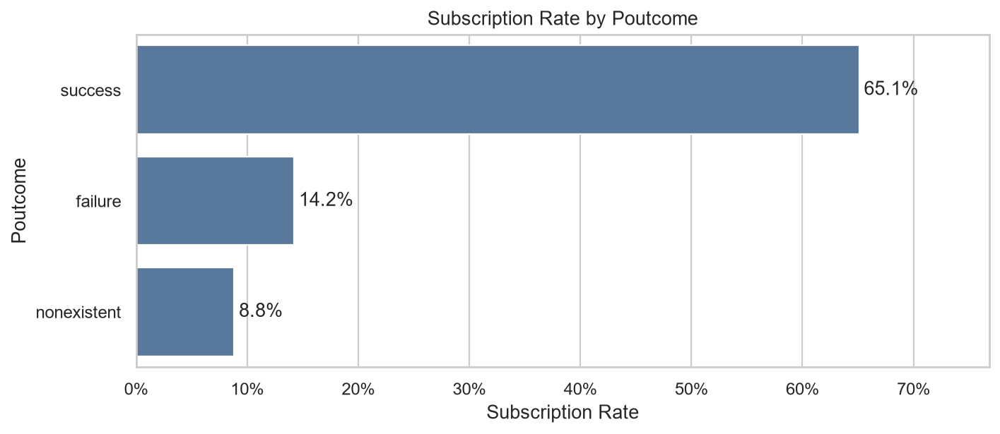
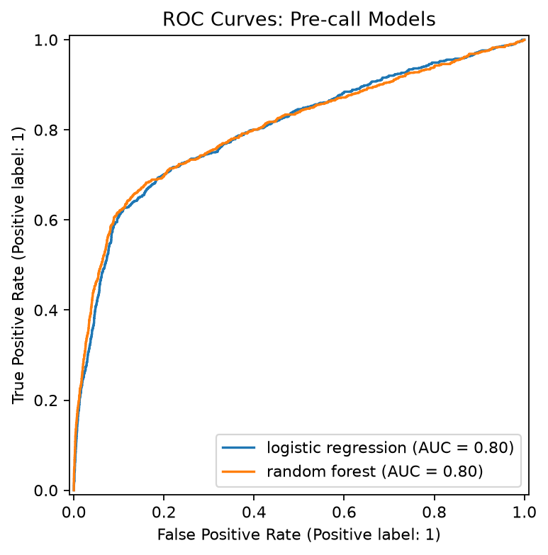
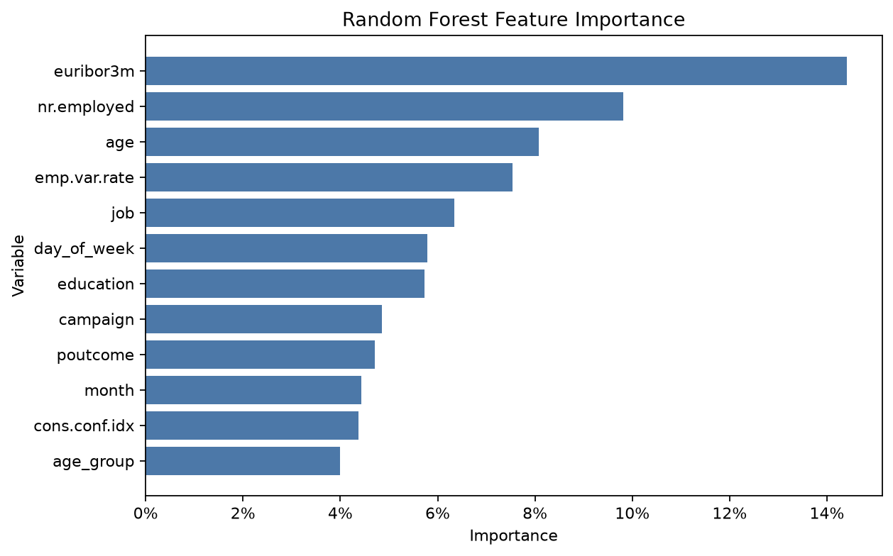
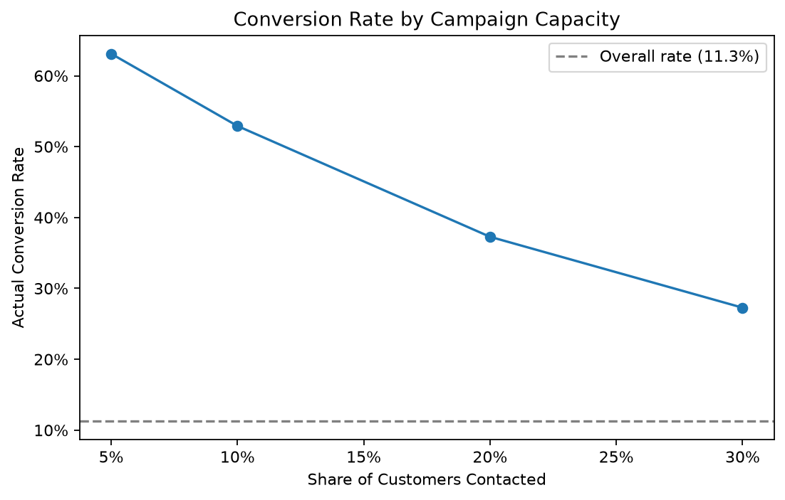

# 银行营销定期存款预测分析报告

## 执行摘要

本项目使用 41,176 条清洗后的银行营销记录，建立通话前客户筛选模型，帮助营销团队将电话资源优先投向更可能订购定期存款的客户。随机森林在独立测试集上的 ROC-AUC 为 0.803，PR-AUC 为 0.487，优于逻辑回归。

最具执行价值的结论是按模型评分排序联系客户。测试集中，优先联系评分前 10% 的 824 名客户，实际转化率为 52.9%，而全体客户的基准订购率仅为约 11.3%；该策略覆盖了 47.0% 的潜在订购客户。若团队容量允许，联系前 20% 客户可覆盖 66.2% 的潜在订购客户，实际转化率仍为 37.3%。

## 1 研究目标

银行电话营销成本较高，且绝大多数客户不会订购定期存款。本项目回答以下问题：

- 哪些客户和营销情境具有更高订购概率？
- 能否在本次通话开始前筛选高潜力客户？
- 在电话容量受限时，应优先联系多大比例的客户？

研究目标是改善营销资源分配，而不是自动决定是否联系某一位客户。

## 2 数据与清洗

项目采用提供的 `bank-additional-full.csv` 作为主分析数据。原始数据包含 41,188 条记录和 21 个字段，覆盖客户人口属性、贷款与联系信息、既往营销结果及宏观经济指标。

清洗过程移除了 12 条完全重复记录，得到 41,176 条记录。数据没有空值。`job`、`marital`、`education`、`default`、`housing` 和 `loan` 中的 `unknown` 被保留为显式类别，因为它表示客户信息未知，而不是确认的缺失值。

目标变量为是否订购定期存款：`target_subscription=1` 代表 `yes`，`0` 代表 `no`。清洗后正类比例约为 11.3%，存在明显类别不平衡。

## 3 探索性分析

历史营销结果是最显著的业务信号。既往营销成功的客户，本次订购率为 65.1%；既往失败为 14.2%；无既往营销记录为 8.8%。这表明再营销和历史响应记录值得作为客户优先级的重要输入。

联系渠道也存在明显差异。通过 `cellular` 联系的客户订购率为 14.7%，高于 `telephone` 的 5.2%。客户职业分组中，`student` 的订购率为 31.4%，`retired` 为 25.3%，而 `blue-collar` 为 6.9%。这些结果用于辅助客群分层，不应作为单一联系规则。

不同月份的转化率不同，但部分月份样本较少，且月份与营销安排、经济环境可能共同变化。因此，月份结果应作为活动排期的参考，而不能被解释为直接因果效应。

## 4 特征工程与数据划分

本项目构建的是通话前预测模型，因此排除了 `duration`。该字段是本次通话持续时间，只能在通话结束后获得，使用它会造成信息泄露。

特征工程包括年龄段、是否曾被联系、距上次联系天数，以及住房贷款和个人贷款标记。原始 `pdays=999` 被解释为此前未联系，并转换为相应业务特征。

数据按 80/20 进行分层抽样，随机种子为 42。训练集包含 32,940 条记录，测试集包含 8,236 条记录，两者的订购率均保持在约 11%，测试集仅用于最终效果评估。

## 5 模型比较

类别变量通过独热编码处理，数值变量采用中位数填补和标准化。比较了逻辑回归与随机森林，两者均使用类别权重处理正负样本不平衡。

| 模型 | ROC-AUC | PR-AUC | Precision | Recall |
|---|---:|---:|---:|---:|
| 随机森林 | 0.803 | 0.487 | 0.452 | 0.610 |
| 逻辑回归 | 0.801 | 0.448 | 0.363 | 0.650 |

随机森林的 ROC-AUC 与逻辑回归接近，但在更适合不平衡分类问题的 PR-AUC 与精准率上更优。因此，后续业务筛选采用随机森林评分。

## 6 模型解释

随机森林的重要变量包括 `euribor3m`、`nr.employed`、`age`、`emp.var.rate`、`job`、`education`、`campaign`、`poutcome` 和 `month`。

宏观指标可帮助判断整体市场环境，但营销团队的直接行动应更多依赖既往营销结果、客户评分和联系策略。年龄、职业和教育程度适合用于辅助分层，应避免单独作为客户排除条件。特征重要性描述模型对历史数据的使用程度，不代表变量对订购行为的因果作用。

## 7 营销容量策略

随机森林输出的概率可用于对客户排序。容量评估基于独立测试集，结果如下：

| 优先联系范围 | 联系客户数 | 实际转化率 | 覆盖潜在订购客户 |
|---|---:|---:|---:|
| 前 5% | 412 | 63.1% | 28.0% |
| 前 10% | 824 | 52.9% | 47.0% |
| 前 20% | 1,647 | 37.3% | 66.2% |
| 前 30% | 2,471 | 27.3% | 72.6% |

建议将“前 10%”作为资源紧张时的优先名单。它将实际转化率提升至基准水平的约 4.7 倍。若目标是提高潜在客户覆盖率，且团队可承担更多外呼量，可扩展至前 20%。最终比例应结合单次电话成本、单笔定期存款收益、合规要求和团队产能共同确定。

## 8 落地建议

1. 每次活动前使用随机森林对候选客户评分，并按分数建立外呼名单。
2. 优先覆盖历史营销成功客户，并将 `cellular` 作为更优先的联系渠道。
3. 在资源有限时联系评分前 10% 的客户；有扩容空间时使用前 20% 策略。
4. 将实际订购结果回流到训练数据，按活动周期重新评估模型表现与阈值。
5. 监测不同客群的触达和转化结果，避免以年龄、职业或教育水平作为唯一决策依据。

## 9 局限性

本分析基于历史营销数据，不能证明变量之间存在因果关系。宏观指标和月份可能反映时间变化，也可能与营销计划共同变化。模型结果还应在新的活动周期中验证，并结合电话成本、存款收益和合规要求确定最终阈值。模型不应使用本次通话时长等通话后信息进行通话前筛选。

## 10 可复现性

完整流程位于 `notebooks/01_data_understanding.ipynb` 至 `notebooks/07_model_interpretation.ipynb`。清洗、特征工程、模型和绘图函数存放于 `src/`，中间数据与模型评估产物存放于 `data/processed/`、`figures/` 和 `reports/`。
